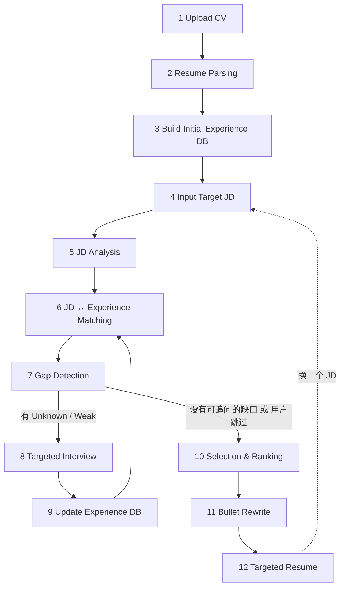

# Workflow v1（以 Paxton 的 12 步为骨架）

> 2026 年 10 月的设计草案，保留作历史记录，文中"待定"的事项不会再更新。与代码不一致时以代码为准（代码说明见根目录 `AGENTS.md`，进度见 `CHANGELOG.md`）。

约定：C = Christine，S = Shera，J = Ziyue，P = Paxton。本文是 Week2「最终 Workflow 图」的草案，v0 范围内每一步写清 Input / Processing / Output / 是否 LLM / 是否 Agent。

## 0. 两条设计原则

1. **控制流由代码决定，LLM 只做理解和生成**。v0 里没有任何一步让模型自己决定下一步做什么，所以"是否 Agent"一栏全部为否。（借鉴 C 的"主编是代码，AI 是员工"）
2. **经历库一次建好，多个 JD 反复用**。步骤 1–3 只做一次；每来一个新 JD 就从步骤 4 循环到 12。这就是"Different JD Versions"的实现方式。

## 1. 流程图

8 → 9 → 6 是一个**回环**：追问补进新事实后，重新匹配，再看缺口是否变化，直到没有值得追问的缺口或用户选择跳过。

## 2. 逐步说明

| # | 步骤 | Input | Processing | Output | LLM | Agent |
|---|---|---|---|---|---|---|
| 1 | Upload CV | PDF / 文本 | 文本提取（代码） | 原始文本 | 否 | 否 |
| 2 | Resume Parsing | 原始文本 | LLM 结构化抽取，按 schema 校验，不合格重试 | affiliations + cards（字段带 source=cv_parse） | 是 | 否 |
| 3 | Build Initial Experience DB | 解析结果 | 写入数据库，给每张卡算"已有哪些价值点、缺哪些" | 初始经历库 | 否 | 否 |
| 4 | Input Target JD | JD 文本 | 保存 JD 原文 | jd 记录 | 否 | 否 |
| 5 | JD Analysis | JD 文本 | LLM 结构化抽取 | must_have / preferred / responsibilities / keywords / domain / seniority，每条要求一个 id 和优先级 | 是 | 否 |
| 6 | JD ↔ Experience Matching | 要求列表 + 经历库 | LLM 逐条要求找证据，**必须引用具体 card 与 field，没有引用就算没有证据** | 每条要求对应的证据指针 + 强弱 | 是 | 否 |
| 7 | Gap Detection | 匹配结果 + 各字段状态 | **规则判断**（见下） | 每条要求的状态：Covered / Weak / Unknown / True Gap | 否 | 否 |
| 8 | Targeted Interview | 按优先级排序的缺口 | 代码选下一个要问的缺口 → LLM 把它说成一句自然的问话 → 用户回答 → LLM 把回答抽取进格子 | 对话 + 候选新事实 | 是（提问、抽取两次） | 否 |
| 9 | Update Experience DB | 候选新事实 | 写库；数字类事实标 ai_inferred，等用户确认 | 更新后的经历库 | 否 | 否 |
| 10 | Selection & Ranking | 经历库 + 匹配结果 | 按覆盖的 must_have 加权打分，按篇幅预算取舍，给出每张卡入选/落选的原因 | 排序后的卡片清单 + 理由 | 少量 | 否 |
| 11 | Bullet Rewrite | 入选卡片中**已确认**的事实 | LLM 改写成 action + what + method + result；每条 bullet 带来源事实 id；改写后代码检查 bullet 里的数字是否都来自已确认的成果 | bullets | 是 | 否 |
| 12 | Targeted Resume | bullets + 模板 | 按 ATS 规则拼装（成员 A 的规则）；用 Rubric（成员 B）和优秀简历做评估 | 简历 + 评估记录 | 评估时用 | 否 |

### 步骤 7 的判断规则（规则化，不让 LLM 拍板）

| 状态 | 判定 |
|---|---|
| Covered | 至少一条**已确认**的强证据 |
| Weak | 有证据，但缺动作、缺个人贡献或缺结果之一 |
| Unknown | 有相关经历，但细节不足以判断（信息缺口，值得问） |
| True Gap | 没有相关经历，**且用户被问过后确认没做过**（没问过之前只能是 Unknown） |

这样 Unknown（信息缺口）和 True Gap（真缺口）才分得开，这也是问题概述里要和 Huntr/Rezi 对比的点。

### 步骤 8 的两种追问模式

- **JD 驱动（主模式）**：问题概述的设定，只追问对这个 JD 值得深挖的地方。
- **通用补全（兜底）**：卡片本身缺基础价值点，或用户没有 CV 从零开始时，按 C 的 8 个价值点（背景难点、我的动作、决策取舍、协作、方法工具、量化结果、规模、收获）补问。

追问的停止条件待定：最多 N 题、用户主动跳过、或没有可追问的缺口。

## 3. 从 C 和 S 借鉴什么

### 借鉴 C

| 内容 | 用在哪一步 |
|---|---|
| 每个事实带状态（用户确认 / AI 推断 / 待补充）和出处 | 步骤 2、9、11，是整个流程的底线："简历只能用已确认的事实" |
| 成果的结构 `{数值, 单位, 口径, 状态}`，没数字就是空 | 步骤 8、9、11 的防编造检查 |
| 经历三层结构：经历归属 → 卡片 → 格子 | 步骤 2、3 的存储 |
| "主编决定问什么，记者负责措辞，速记员负责抽取"的分工 | 步骤 8 的实现 |
| 一次问答的七步调用链（存原话 → 取卡 → 抽取 → 存回 → 看缺口 → 提问 → 返回） | 步骤 8–9 的内部细节 |
| 挖掘框架的 8 个价值点 | 步骤 8 的兜底模式；步骤 3 判断卡片完整度 |
| "缺什么"不存，每次现算 | 步骤 7 |
| 7 张表（含对话记录、修改记录） | 步骤 3、9 的数据库 |

### 借鉴 S

| 内容 | 用在哪一步 |
|---|---|
| **个人行动与团队行动分开存** | schema（步骤 2、8），直接对应"说不清我的贡献" |
| 经历类型枚举（实习、课程项目、个人项目、科研、社团、比赛、志愿） | schema 的 affiliation.type |
| 每个入选经历展示"推荐原因 + 匹配程度 + 原始事实依据" | 步骤 10 的输出内容 |
| 事实只维护一份，目标语言在表达层生成 | 约束步骤 11–12 的设计（具体双语流程见下方"暂缓"） |
| 导出前提醒"还有未确认信息" | 步骤 12 的检查项 |

## 4. 暂缓（等开发完成后再回看 C 和 S 的细节）

这些偏前端或产品细节，不影响 workflow 骨架，v0 不做：

- 用户进入时选择目标岗位、简历语言（中文/英文）、从零开始还是上传旧简历
- 姓名、邮箱、电话等基本信息的填写
- 10–15 分钟问答的节奏设计、对话语气（J 的对话体验部分）
- 拖拽组装、调整 section 顺序、右侧实时预览与分页提醒
- PDF / DOCX 导出
- 同一份经历库生成另一种语言版本的完整流程
- 一条 bullet 多种写法供选、逐条审阅模式
- 邮件发送、AI 查重、用户自定义排版 skills、模拟面试、桌宠与积分商城

## 5. 需要你拍板的两件事

1. **CV 里解析出来的内容，算"用户确认"还是"AI 推断"？** CV 是用户自己写的，我倾向标为已确认（source = cv_parse），解析器只做结构化、不添加内容；但老简历可能有夸大，所以也可以统一标为待确认，在步骤 8 里顺手核实。
2. **步骤 8 的停止条件**：固定最多几题，还是按缺口优先级走到没有可问的为止。
